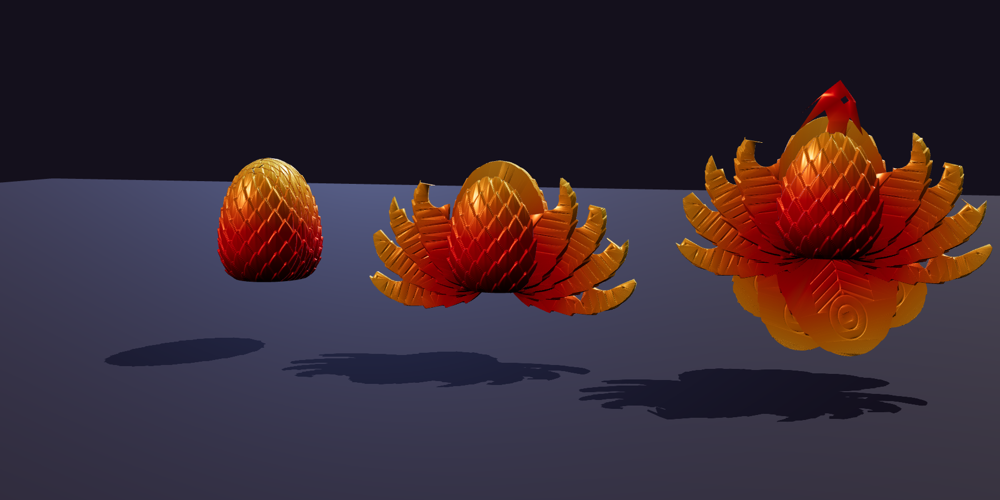
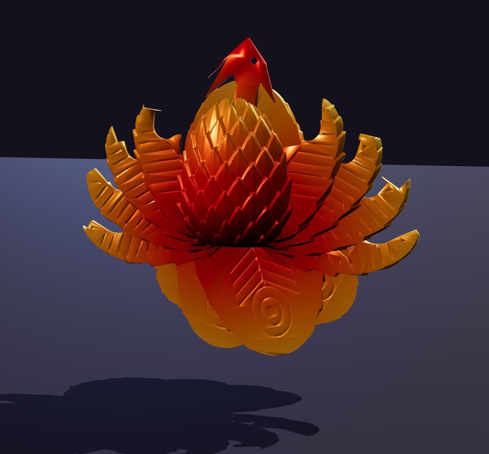

# Emberwing Phoenix Egg — an egg that opens into a phoenix

An original print-in-place toy. Closed, it is a feather-scaled egg. Opened, the slices of the
egg swing out to become two wings, a fanned tail and a head with beak and crest. It prints as
one piece with no supports and no assembly.

The images are computer renders of the actual print file. **The model has not been physically
printed yet.** Print and tune one test copy before ordering stock (see "What to watch on the
first print").

## How it works

The egg is cut into upright slices, like a loaf of bread standing on end.

| Part | Count | What it does |
|---|---|---|
| Body | 1 | Centre plate, front chest dome and rear dome, joined by the hinge axles. |
| Wing feathers | 8 | The four slices in front of the centre, each split left and right along a flame-shaped line. They swing out on two low hinges. |
| Tail plumes | 4 | The four slices behind the centre. They swing down on one hinge and fan out. |
| Head | 1 | Neck, beak, eye and crest. It is stored upside down inside the front slice and folds up. |

- **Every hinge has a stop.** Each axle has a rib along its top and each feather has a matching
  slot, so every feather opens to its own fixed angle (wings 40° to 106°, tail fanned 64° wide,
  head 190°). The same pose appears every time.
- **Gravity holds the pose.** With the body upright, the open wings rest on their stops, the
  tail hangs, and the head leans just past upright onto its stop.
- **Order of opening:** wings first, then the head. The head needs the wings out of its way,
  and must be folded down again before the wings close. The tail is independent.
- **Size:** 66 × 66 × 75 mm closed; about 164 mm wide and 150 mm tall open.

An interactive 3D model of the transformation is published as a Claude artifact
(https://claude.ai/artifact/LqgFLk7c7Kf9z8YfPWFVqD; private to its owner unless shared).

## Files

| File | Notes |
|---|---|
| `stl/phoenix_egg.stl`, `3mf/phoenix_egg.3mf` | Print file, in the closed position, standing upright. |
| `generate_phoenix_egg.py` | Parametric source. Regenerates the files and re-runs every check. |

Checks the generator runs on each build:

- 14 separate parts, each one solid piece, watertight, none touching (tightest gap 0.24 mm at
  the hinge stops, 0.5 mm between slices).
- Every wing feather and tail plume opens through its full range without hitting anything.
- The head rises freely once the wings are open, and nothing overlaps in the open pose.
- Every hinge is blocked just past both ends of its range, and no part can slide off its axle.

Print at 100 % or larger. Scaling down shrinks the gaps and the parts will fuse.

## Print settings

| Setting | Value |
|---|---|
| Material | PLA; silk gradient or tri-colour PLA for the look |
| Nozzle / layer height | 0.4 mm / 0.2 mm |
| Walls | 3 |
| Infill | 15 % gyroid (only the body has room for infill) |
| Supports | **None** |
| Brim | 5 mm outer brim; the slices are tall and thin |
| Seam | Aligned or back |
| Speed | Outer walls about 60 mm/s or slower |
| Cooling | 100 % fan after the first layer (the axles print as short bridges) |
| Orientation | As exported, flat base down |

Estimated material is 110–130 g (the slices print solid; check your slicer). After printing,
let it cool, peel the brim, then free the parts one at a time: wings, tail, then head.

## What to watch on the first print

These are the places a first print is most likely to need tuning. None has been tested yet.

1. **Slices fused together.** The gaps are 0.5 mm. If they stick, calibrate flow, apply
   −0.1 mm X-Y compensation, or raise `GAP` in the script to 0.6.
2. **Axles stuck in their holes.** Each axle bridges 15 mm between the body plates with a flat
   underside. Good cooling matters here.
3. **Head stuck to its rest.** The stowed head prints on a small shelf with a one-layer gap and
   should snap free with light pressure.
4. **Stops.** The stop ribs are small. They set the pose but will not survive forcing a feather
   past its limit, so the listing should say "do not force".

## Colours

The egg prints upright, so a filament that changes colour along the spool gives bands from base
to tip. Because every feather is a slice of that egg, the bands carry onto the open phoenix:
feather roots take the base colour and tips take the top colour.

| Colorway | Filament |
|---|---|
| Fire | Silk gradient red → orange → gold |
| Rainbow | Silk "fast-change" rainbow PLA |
| Aurora | Silk gradient violet → magenta → ice blue |

Choose "fast colour change" spools; ordinary gradient spools change too slowly to show more
than two colours on a 75 mm egg.

## Where to get it made, and selling on TikTok Shop

The full production comparison and selling checklist are in
[`../phoenix-flexi/README.md`](../phoenix-flexi/README.md). They apply here with one
difference: this egg uses roughly 2.5 times the filament of that toy, so in-house cost is about
$3–5 per unit. In short:

- **Cheapest:** your own Bambu A1 printers (about $299 each).
- **Best hands-off option:** Slant 3D, a US print farm that ships each order and lists a TikTok
  Shop integration. Upload the file for a real quote.
- **Main hurdle:** TikTok Shop treats this as a children's toy, so budget for a Children's
  Product Certificate and lab testing before listing.
