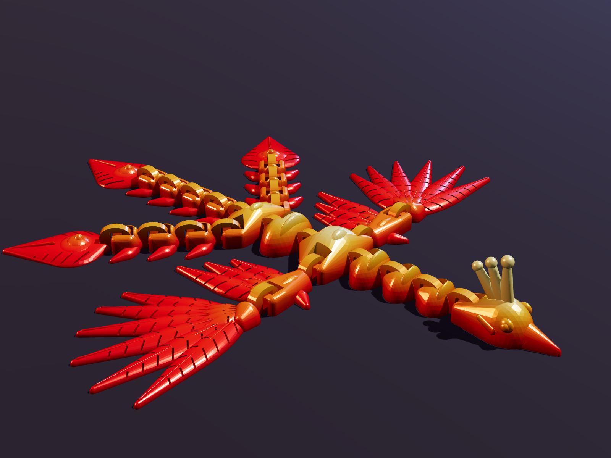
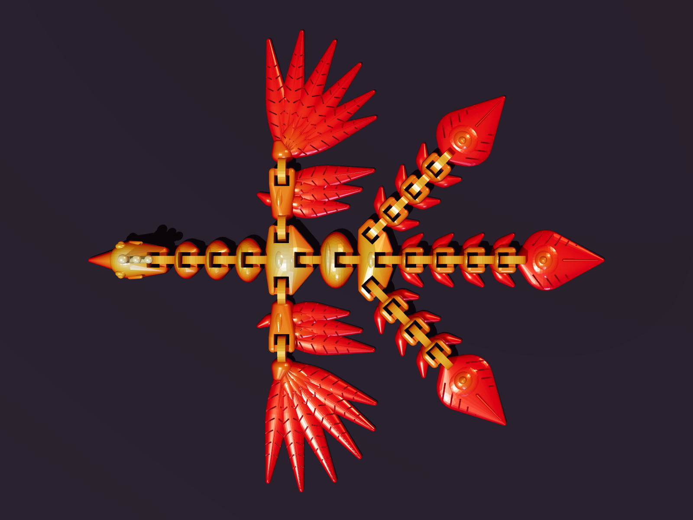
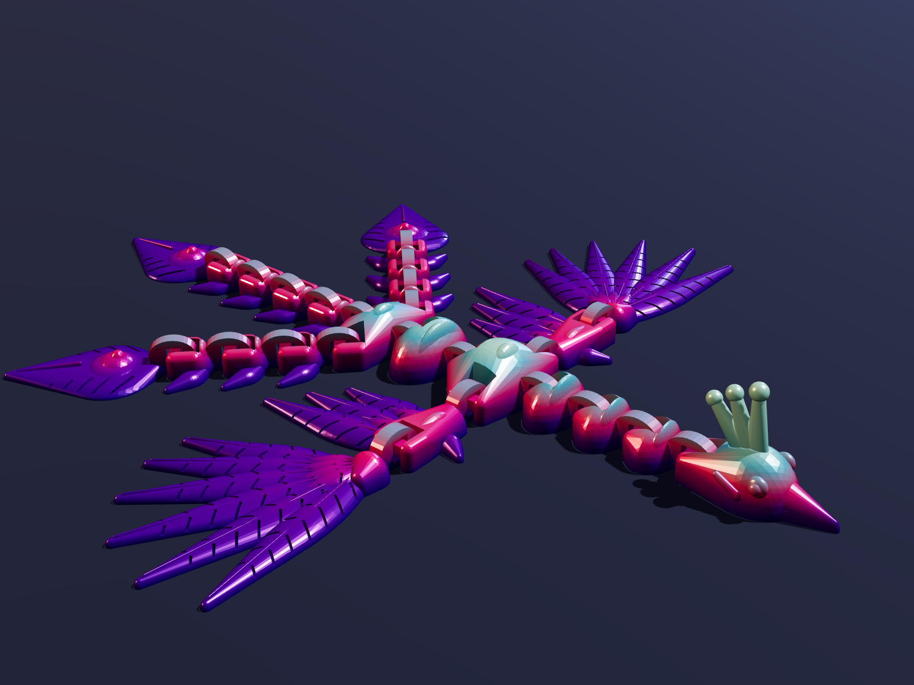
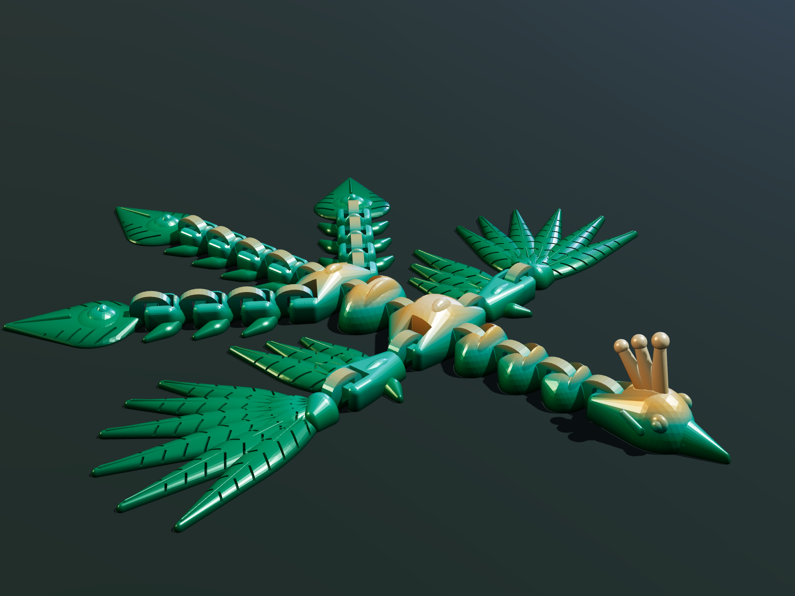

# Emberwing — articulated print-in-place phoenix

An original flexi toy: a phoenix with a wiggling spine, flapping two-part wings and three
articulated tail plumes ending in "eye" feathers. It prints as one piece, with no supports and
no assembly, using the same captive chain-link joints as the popular flexi dragons.

| Top view (as it sits on the bed) | Aurora colorway | Jade colorway |
|---|---|---|
|  |  |  |

The images are computer renders of the actual print files, coloured to show the layer-swap
colorways described below. **The model has not been physically printed yet** — print one test
copy before ordering stock (see "Before you sell").

## Files

| File | Size (mm) | Fits |
|---|---|---|
| `stl/emberwing_phoenix_100pct_256bed.stl` (and `3mf/`) | 237 × 213 × 28 | Bambu A1 / P1S / X1 and other 256 mm beds |
| `stl/emberwing_phoenix_85pct_220bed.stl` | 202 × 181 × 24 | 220 mm beds (Ender 3, Prusa MK4 at a slight angle) |
| `stl/emberwing_phoenix_70pct_180bed.stl` | 166 × 149 × 20 | 180 mm beds (Bambu A1 mini) |
| `generate_phoenix.py` | — | Parametric source; regenerates every file and re-runs the checks |

Do not scale below 70 %: the joint clearance drops under 0.7 mm and links may fuse.

What the generator verifies on every build:

- 24 separate links, each one solid piece, all watertight.
- No two links touch; the tightest gap is 1.0 mm at full size.
- All 23 joints are captive (a link cannot be pulled out in any direction).
- The only unsupported surfaces are the short bridges inside the joints (≤ 7 mm span).

## Print settings

| Setting | Value |
|---|---|
| Material | PLA (silk PLA for the look; see colours) |
| Nozzle / layer height | 0.4 mm / 0.2 mm |
| Walls | 3 |
| Top / bottom layers | 5 / 4 |
| Infill | 15 % gyroid |
| Supports | **None** |
| Brim / raft | None; use a clean textured PEI plate |
| Elephant-foot compensation | 0.15 mm (slicer default is fine) |
| Bridge fan | 100 % |
| Speed | Normal profile; for silk PLA cap outer walls at ~60 mm/s for best shine |
| Orientation | As exported, flat side down |

Estimated material at full size is 40–50 g (the solid volume is 46 cm³; the real figure comes
from your slicer). After printing, let the plate cool, then flex each joint once to free it.

## Colours

The model is one body, so colour comes from the filament. Three ways, cheapest first:

1. **Tri-colour silk PLA (no extra work).** The filament itself shifts colour with viewing
   angle. Red-gold-orange for "Fire", blue-purple-teal for "Aurora", green-gold for "Jade".
2. **Rainbow / gradient silk PLA.** Colour changes along the spool, so every unit is unique.
3. **Layer swaps (what the renders show).** Change filament at set heights. Works on any
   printer with a pause; automatic with an AMS.

| Colorway | 0–3 mm (feathers) | 3–7 mm (body) | 7 mm and up (ridges, crest) |
|---|---|---|---|
| Fire | Silk crimson | Silk orange | Silk gold |
| Aurora | Silk violet | Silk magenta | Silk ice blue |
| Jade | Silk emerald | Silk teal | Silk gold |

## Where to get it made

No service publishes a price list; every one quotes after you upload the file. The figures
below are estimates calculated from published rates in November 2026, not quotes for this part.

| Option | Est. cost per unit | Ships orders for you | Notes |
|---|---|---|---|
| **Your own Bambu A1** (~$299) | **$2–3.50** | No | Cheapest by far. One printer makes about 100 units a month. |
| **Slant 3D** (US print farm) | Quote on upload | Yes | The only farm found that lists a TikTok Shop integration; no minimum order. |
| X3D Studios (US) | ~$10 + shipping | Not confirmed | $0.12/g published rate; 10 % off from 10 units. |
| PrintPort3D (US) | ~$20 + shipping | Yes | Charges by print hour, which penalises a long print. |
| JLC3DP / PCBWay (China) | Quote on upload | No | Likely the lowest outsourced part price in bulk, but add freight and about 40 % import duty; silk filament not confirmed. |
| Craftcloud | $13–18+ | No | Useful for comparing quotes, not for production. |
| Xometry, Protolabs, Shapeways, Sculpteo | $60+ | No | Engineering bureaus; not suited to a low-cost toy. |

**Recommendation**

- **Cheapest:** print in-house on Bambu A1 printers. At about $3 a unit against $10–20
  outsourced, a printer pays for itself within the first 30–40 units.
- **Best hands-off option:** Slant 3D, because it prints and ships each order from the US and
  connects to TikTok Shop. Upload the STL for a real quote and ask whether they stock silk
  tri-colour filament before committing.
- **Suggested path:** make the first 50–300 units yourself to prove demand, then add printers
  or send overflow to Slant 3D.

## Before you sell

1. **Print a test copy** and check that every joint moves freely and survives a hard pull.
2. **Toy compliance is the main hurdle on TikTok Shop.** A colourful animal toy will be treated
   as a children's product. Expect to need a Children's Product Certificate, a test report
   from a CPSC-accepted lab (ASTM F963; roughly $400–1,200 per product, estimate), and a
   tracking label on the product and packaging. Labelling it "14+ collectible" does not
   reliably avoid this.
3. **Limit colourways at launch.** Each filament colour may be tested as a separate material.
4. **Keep stock.** Orders generally need a carrier scan within about two business days, which
   is too tight for printing to order.
5. **Fees:** TikTok Shop's referral fee is about 6–8 %, plus payment processing and any
   creator commission.
6. **Licensing:** this is an original design generated by the script in this folder, so no
   third-party commercial licence is needed.
