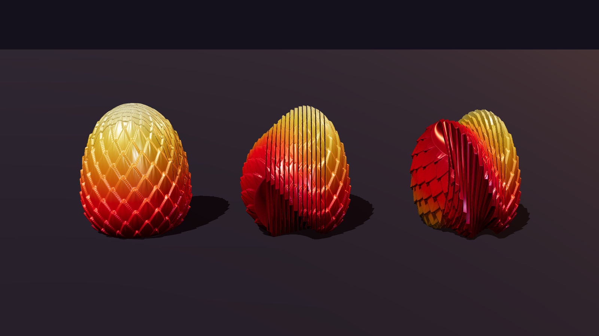
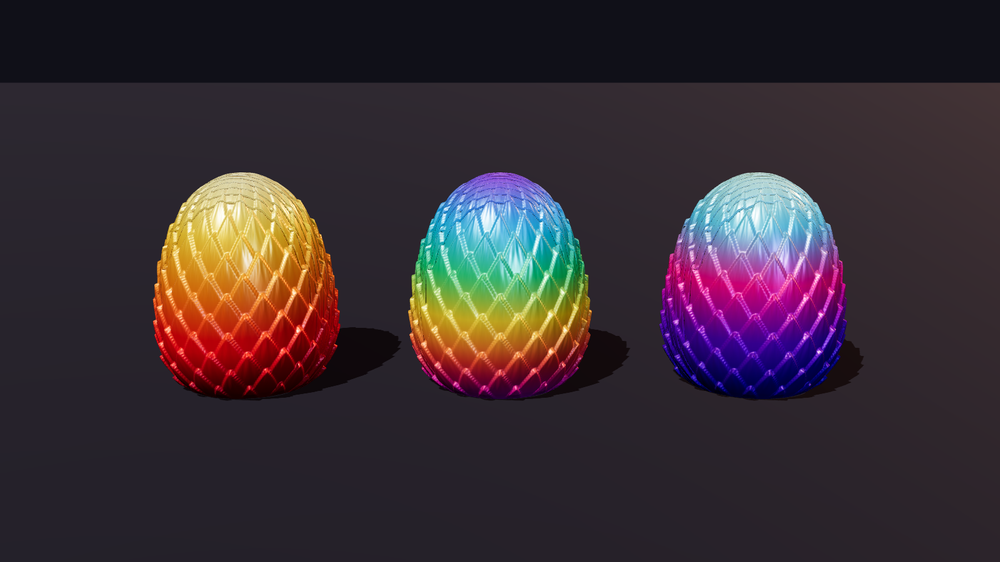
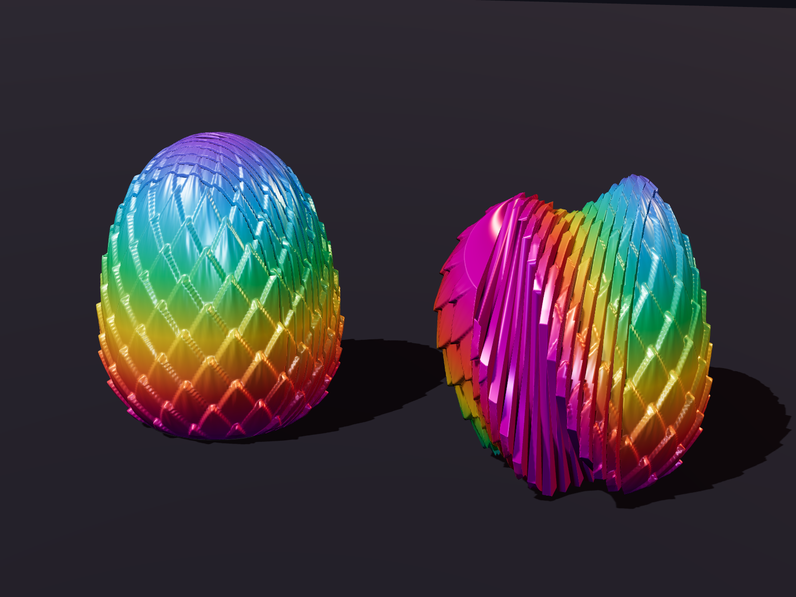

# Emberwing Phoenix Egg — twisty fidget egg

An original print-in-place fidget toy with the same mechanic as the "twisty dragon egg": a
scaled egg that twists open into a spiral fan and snaps back closed. This one is a phoenix
egg, covered in upward-pointing flame feathers instead of dragon scales.

| Colorways (Fire, Rainbow, Aurora) | Rainbow, closed and open |
|---|---|
|  |  |

The images are computer renders of the actual print file. **The model has not been physically
printed yet** — print and tune one test copy before ordering stock.

## How it works

- The egg is cut into 13 thin blades (2 mm each) and two end caps, 15 parts in all.
- All parts turn on one hidden axle through the middle of the egg. A flange on the axle,
  trapped inside one cap, keeps the stack from ever coming apart.
- Each part has a small stop pin that rides in a curved track in its neighbour. This lets
  every joint turn 11° and no further, so the whole egg twists 154° end to end.
- Twisting back, every pin hits its closed stop at the same time and the egg lines up again.

## Files

| File | Notes |
|---|---|
| `stl/phoenix_twist_egg.stl`, `3mf/phoenix_twist_egg.3mf` | Print file. 66 × 66 × 75 mm, prints standing up. |
| `generate_egg.py` | Parametric source. Regenerates the files and re-runs all checks. |

Checks the generator runs on every build:

- 15 separate parts, each one solid piece, watertight, none fused together.
- Every joint turns freely through its 11° and is blocked beyond it in both directions.
- Nothing collides with the egg half open or fully open.
- The end cap cannot be pulled off the axle.

Print at 100 %. Scaling down shrinks the 0.5 mm gaps between blades and they will fuse;
scaling up (to 150 %) is fine.

## Print settings

| Setting | Value |
|---|---|
| Material | PLA; silk rainbow or tri-colour PLA for the look |
| Nozzle / layer height | 0.4 mm / 0.2 mm (the axle clearance is designed for 0.2 mm layers) |
| Walls | 3 |
| Infill | 15 % gyroid (only the two caps have room for infill) |
| Supports | **None** |
| Brim | 5 mm outer brim — the blades are tall and thin and need the grip |
| Seam | Aligned or back; random seams roughen the gaps |
| Speed | Outer walls about 60 mm/s or slower |
| Cooling | 100 % fan after the first layer |
| Orientation | As exported, flat base down |

Estimated material is 110–130 g (the blades print solid; check your slicer). After printing,
let it cool fully, peel the brim, then twist firmly once to free the axle and blades.

If the blades come out stuck together, the usual fixes are lower flow (calibrate the extrusion
multiplier), a 0.1 mm negative "X-Y hole/contour compensation", or raising `GAP` in
`generate_egg.py` from 0.5 to 0.6.

## Colours

The egg prints upright, so a filament that changes colour along the spool gives horizontal
bands from base to tip, the same effect as the eggs in the reference video.

| Colorway | Filament |
|---|---|
| Fire | Silk gradient red → orange → gold, or tri-colour silk red/gold/orange |
| Rainbow | Silk "fast-change" rainbow PLA (short colour transitions, so each egg shows the full range) |
| Aurora | Silk gradient violet → magenta → ice blue |

Pick "fast colour change" spools: ordinary rainbow spools change too slowly to show more than
two colours on a 75 mm egg.

## Where to get it made, and selling on TikTok Shop

The production comparison and the selling checklist are in
[`../phoenix-flexi/README.md`](../phoenix-flexi/README.md) and apply to this egg as well, with
one difference: this egg uses roughly 2.5 times the filament, so in-house cost is about
$3–5 per unit rather than $2–3.50, and services that charge by weight will quote
proportionally more. The short version:

- **Cheapest:** your own Bambu A1 printers (about $299 each).
- **Best hands-off option:** Slant 3D, a US print farm that ships each order for you and
  lists a TikTok Shop integration. Upload the file for a real quote.
- **Main hurdle:** TikTok Shop treats this as a children's toy, so budget for a Children's
  Product Certificate and lab testing before listing.

The articulated phoenix in `../phoenix-flexi/` is a companion piece: the "hatchling" for this
egg, which could sell as a bundle.
